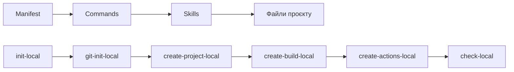

# Архітектура AI-агента

## 1. Які проблеми вирішує агент

Агент усуває ручне та неповторюване налаштування проєкту, додає єдиний сценарій перевірки та зменшує різницю в поведінці проєкту на різних операційних системах.

## 2. Skills

| Назва | Призначення | Вхід | Вихід |
|---|---|---|---|
| `project-scaffold` | Створює базову структуру Python-проєкту Hello World і налаштовує запуск через venv | Назва проєкту, мова Python, бажані шляхи файлів | Створені файли проєкту, список пропущених існуючих файлів |
| `build-and-test` | Налаштовує збірку, запуск, тестування pytest і формування виконуваного файлу `hello` через PyInstaller | Шляхи вихідного коду, тестів і зібраних артефактів; вимоги Python-проєкту | Скрипти збірки, конфігурація залежностей і результати перевірок |
| `github-actions` | Створює CI workflow для перевірки кросплатформної збірки | Назви ОС, команда тестування, параметри збірки | `.github/workflows/ci.yml` і параметри перевірки для ubuntu, windows і macos |

## 3. Commands

| Назва | Що викликає | Що створює/перевіряє |
|---|---|---|
| `git-init-local` | Ініціалізацію Git-репозиторію та базову Git-підготовку | Перевіряє стан репозиторію, створює або не дублює Git-налаштування |
| `create-project-local` | Skill `project-scaffold` | Створює структуру Hello World на Python і файли проєкту |
| `create-build-local` | Skill `build-and-test` | Створює `ci.sh`, `ci.bat`, вимоги та налаштування збірки PyInstaller; перевіряє збірку й pytest |
| `create-actions-local` | Skill `github-actions` | Створює workflow GitHub Actions для ubuntu, windows і macos |
| `check-local` | Усі команди та skills після створення артефактів | Перевіряє структуру, збірку, тестування й коректність workflow |
| `init-local` | Оркестратор послідовності ініціалізації | Послідовно викликає `git-init-local`, `create-project-local`, `create-build-local`, `create-actions-local` і `check-local` |

## 4. Схема взаємодії

## 5. Дані, що передаються між етапами

- Назва проєкту.
- Мова програмування та версія середовища запуску.
- Шляхи створених файлів та каталогів.
- Список файлів, пропущених як уже існуючих.
- Результати перевірок збірки, тестів, скриптів і workflow.
- Рекомендації або причини помилок.

## 6. Обробка помилок оркестратором

Оркестратор зупиняється на першій помилці, показує її причину та пропонує конкретну рекомендацію. Помилки не приховуються, а повідомлення про успіх не видається без успішного завершення `/check-local`.

## 7. Ідемпотентність

Кожна команда перевіряє наявність цільового файлу або налаштування перед зміною. Існуючі файли не перезаписуються й не дублюються; про пропущені елементи повідомляється окремим списком.

Повторний запуск `/init-local` виконує перевірку наявності кожного артефакту та повторно працює лише з відсутніми елементами.

## 8. Відповідність файлів Copilot ролям

| Файл або каталог | Роль |
|---|---|
| `.github/agents/build-engineer.agent.md` | Manifest оркестратора та опис ролі build-engineer |
| `.github/prompts/*.prompt.md` | Commands: окремі керовані сценарії агента |
| `.github/skills/*/SKILL.md` | Skills: реалізація повторюваних процедур створення та перевірки |
| `.github/workflows/ci.yml` | CI для GitHub Actions |

Використано формат GitHub Copilot для VS Code.

## 9. Обмеження агента

- Для виконання змін агент потребує підтвердження дій у Copilot.
- Агент залежить від доступності Python 3 на машині користувача.
- Агент не публікує проєкт, релізи чи інші дані самостійно.
- Агент не змінює захист гілок.
